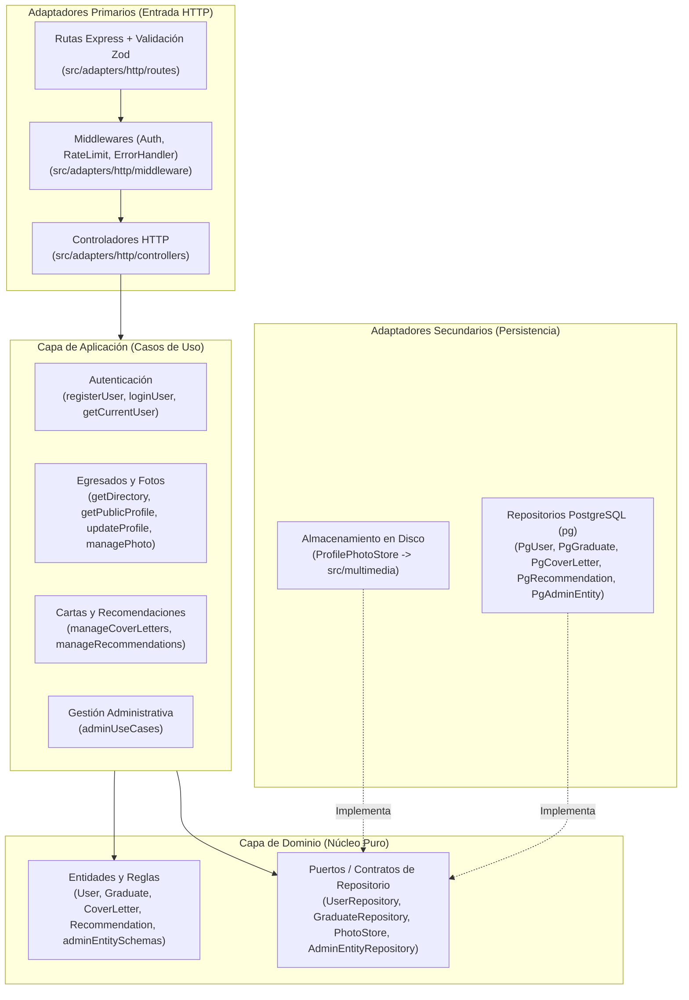

# Arquitectura, Principios SOLID y Estructura del Proyecto

## 1. Arquitectura Hexagonal (Puertos y Adaptadores)

El backend está diseñado siguiendo el patrón de **Arquitectura Hexagonal**, separando estrictamente las reglas de negocio de los detalles técnicos (Express, PostgreSQL, sistema de archivos).



### Regla de Dependencia
1. **`src/domain/`** no importa nada de `application`, `adapters` ni librerías de infraestructura (`express`, `pg`, `multer`).
2. **`src/application/`** orquesta las entidades y depende únicamente de los **puertos (abstracciones)** del dominio.
3. **`src/adapters/`** implementa los controladores HTTP de entrada y los repositorios SQL / sistema de archivos de salida.
4. **[`src/app.js`](../src/app.js)** funciona como **Composition Root**, instanciando los adaptadores concretos e inyectándolos en los casos de uso y controladores.

---

## 2. Aplicación de Principios SOLID

| Principio | Implementación en el Proyecto |
| :--- | :--- |
| **S — Single Responsibility** | Cada caso de uso en `src/application/` cumple una única responsabilidad (`makeRegisterUser`, `makeUploadProfilePhoto`, `makeCreateAdminEntity`). En administración, los esquemas/validaciones viven en [`adminEntitySchemas.js`](../src/domain/admin/adminEntitySchemas.js), las reglas de negocio en [`adminUseCases.js`](../src/application/admin/adminUseCases.js) y el SQL en [`PgAdminEntityRepository.js`](../src/adapters/persistence/postgres/repositories/PgAdminEntityRepository.js). |
| **O — Open/Closed** | Los middlewares [`validateBody`](../src/shared/validation/schemas.js) y [`validateQuery`](../src/shared/validation/schemas.js) admiten nuevos esquemas Zod sin modificarse. El gestor administrativo soporta nuevas columnas o entidades declarando su configuración en `adminEntities`. |
| **L — Liskov Substitution** | Todos los repositorios PostgreSQL (`PgGraduateRepository`, `PgUserRepository`, `PgCoverLetterRepository`, `PgRecommendationRepository`, `PgAdminEntityRepository`) y `ProfilePhotoStore` extienden e implementan íntegramente los contratos base definidos en `src/domain/`. |
| **I — Interface Segregation** | Las funciones fábrica reciben por desestructuración únicamente las dependencias que utilizan. Las lecturas simples de catálogos están segregadas en [`catalogQueries.js`](../src/adapters/persistence/postgres/queries/catalogQueries.js). |
| **D — Dependency Inversion** | Los controladores HTTP nunca invocan repositorios ni almacenamiento de archivos directamente; dependen exclusivamente de los casos de uso inyectados desde [`createApp`](../src/app.js). |

---

## 3. Medidas de Seguridad Implementadas

- **Consultas SQL 100 % Parametrizadas:** Uso de `$1, $2...` con el driver nativo `pg` y listas blancas estrictas para columnas editables.
- **Validación de Entrada con Zod:** Todos los endpoints de escritura (`POST`, `PUT`, `PATCH`) validan tipos, longitudes máximas, formatos UUID, fechas `YYYY-MM-DD` y límites de arreglos.
- **Mitigación de XSS:**
  - Bloqueo de esquemas peligrosos (`javascript:`, `data:`) exigiendo `http://` o `https://` tanto en el backend (`httpUrlSchema`) como en el frontend (`safeExternalLink`).
  - Renderizado en el DOM mediante `textContent` y `createTextNode` en [`public/js/ui.js`](../public/js/ui.js).
  - Cabeceras `Content-Security-Policy` gestionadas con `helmet`.
- **Subida Segura de Archivos:** Validación de firma binaria real (*magic bytes*) para JPEG, PNG y WebP en [`ProfilePhotoStore.js`](../src/adapters/persistence/filesystem/ProfilePhotoStore.js), límite de 5 MB y nombres generados con `crypto.randomUUID()`.
- **Protección de Cuentas y Contenedor:** Contraseñas con `bcrypt` (12 rondas, límite de 72 bytes), `express-rate-limit` en login, registro y recomendaciones, y ejecución del contenedor Docker bajo el usuario sin privilegios `node`.

---

## 4. Estructura Detallada del Proyecto

```text
registro-egresados2/
├── Dockerfile                        # Imagen Node 20-slim ejecutada con usuario 'node'
├── docker-compose.yml                # Orquestación completa: db (Postgres 16) + pgadmin + app
├── docker-compose.standalone.yml     # Alias standalone de la orquestación completa
├── package.json                      # Dependencias y scripts (dev, start, migrate, seed, test)
├── FRONTEND_RULES.md                 # Guía de diseño visual y reglas de UX/UI
├── GUIA_PRUEBAS.md                   # Guía rápida de pruebas y credenciales semilla
├── docs/                             # Documentación técnica del proyecto
│   ├── README.md
│   ├── ARQUITECTURA_Y_ESTRUCTURA.md
│   ├── FUNCIONAMIENTO_Y_API.md
│   └── MODELO_ENTIDAD_RELACION.md
├── migrations/                       # Migraciones SQL versionadas
│   ├── 001_initial_schema.sql        # Tablas principales, enums, checks e índices
│   ├── 002_seed_catalogs.sql         # Catálogo base de tecnologías y habilidades blandas
│   └── 003_admin_entity_management.sql # Borrado lógico (is_active) en las entidades
├── scripts/                          # Scripts de ciclo de vida
│   ├── start.js                      # Espera a Postgres -> corre migrate -> corre seed -> inicia server
│   ├── migrate.js                    # Ejecutor transaccional de migraciones SQL
│   └── seed.js                       # Carga idempotente de admin, 10 egresados con avatares y datos
├── public/                           # Frontend estático (HTML5 + CSS3 + Vanilla JS)
│   ├── index.html                    # Directorio público de egresados
│   ├── perfil.html                   # Ficha pública individual y recomendaciones
│   ├── login.html                    # Inicio de sesión
│   ├── registro.html                 # Registro de cuenta de egresado
│   ├── dashboard.html                # Panel privado "Mi ficha"
│   ├── cartas.html                   # Generador e impresión de cartas de presentación
│   ├── admin.html                    # Panel de Gestión para el Administrador
│   ├── styles.css                    # Hoja de estilos institucional unificada
│   └── js/
│       ├── api.js                    # Cliente HTTP centralizado (fetch con credenciales)
│       ├── ui.js                     # Helpers DOM seguros y barra de navegación dinámica
│       ├── directory.js              # Lógica del directorio público y filtros
│       ├── perfil-publico.js         # Lógica de la ficha pública y envío de recomendaciones
│       ├── login.js                  # Lógica de autenticación
│       ├── registro.js               # Lógica de registro de cuenta
│       ├── dashboard.js              # Lógica de edición de perfil, foto, proyectos y experiencias
│       ├── cartas.js                 # Lógica del editor y vista previa de cartas
│       └── admin.js                  # Lógica de gestión de usuarios, roles, tecnologías y entidades
└── src/                              # Código fuente del Backend
    ├── app.js                        # Composition Root y configuración de Express
    ├── server.js                     # Punto de entrada del servidor HTTP
    ├── config/
    │   ├── env.js                    # Carga y validación de variables de entorno
    │   └── database.js               # Pool de conexiones PostgreSQL y helper transaccional
    ├── shared/
    │   ├── errors/AppError.js        # Jerarquía de errores (400, 401, 403, 404, 409)
    │   └── validation/schemas.js     # Esquemas Zod y middlewares validateBody / validateQuery
    ├── domain/                       # Núcleo de Dominio
    │   ├── user/                     # Entidad User y contrato UserRepository
    │   ├── graduate/                 # Entidad Graduate y contratos GraduateRepository / PhotoStore
    │   ├── coverLetter/              # Entidad CoverLetter, reglas de límites y CoverLetterRepository
    │   ├── recommendation/           # Entidad Recommendation y RecommendationRepository
    │   └── admin/                    # Esquemas declarativos adminEntitySchemas y AdminEntityRepository
    ├── application/                  # Casos de Uso
    │   ├── auth/                     # registerUser, loginUser, getCurrentUser
    │   ├── graduate/                 # getDirectory, getPublicProfile, updateGraduateProfile,
    │   │                             # updateGraduateLists, manageProfilePhoto
    │   ├── coverLetter/              # manageCoverLetters
    │   ├── recommendation/           # manageRecommendations
    │   └── admin/                    # adminUseCases (list, create, update, setActive, roles)
    ├── adapters/
    │   ├── http/                     # Adaptador de entrada (Controllers, Routes, Middlewares)
    │   └── persistence/              # Adaptadores de salida (Postgres Repositories y ProfilePhotoStore)
    └── multimedia/                   # Volumen persistente de fotos de perfil subidas
```
