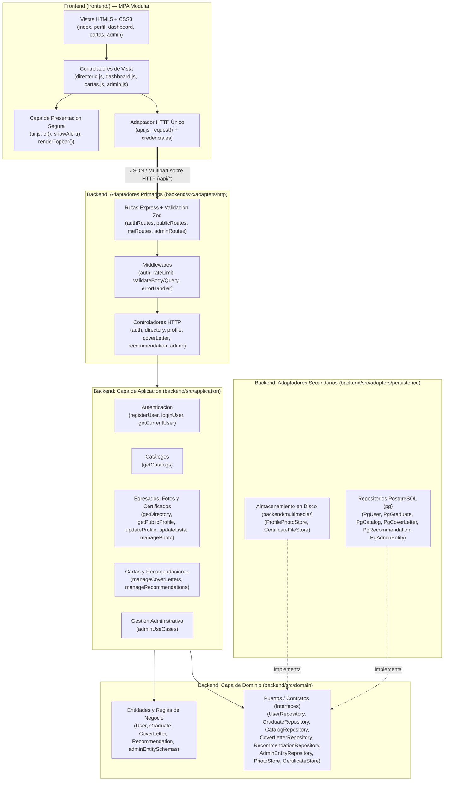

# Arquitectura de Software, Principios SOLID y Seguridad

## 1. Definición Formal de la Arquitectura del Sistema

El sistema utiliza una **Arquitectura Cliente-Servidor Desacoplada** dividida en dos subsistemas independientes dentro del repositorio (`backend/` y `frontend/`):

1. **Backend (`backend/`): Arquitectura Hexagonal (Puertos y Adaptadores / Clean Architecture)**
   - Separa estrictamente la lógica de negocio pura (**Dominio** y **Aplicación**) de los detalles tecnológicos externos (**Adaptadores Primarios HTTP** y **Adaptadores Secundarios de Persistencia en PostgreSQL y Sistema de Archivos**).
2. **Frontend (`frontend/`): Arquitectura Modular MPA (Multi-Page Application) con Adaptador de API Centralizado**
   - Cada vista HTML tiene un controlador de presentación dedicado en `frontend/js/` que delega el 100 % de las llamadas HTTP al módulo único [`frontend/js/api.js`](../frontend/js/api.js) y la construcción segura del DOM a [`frontend/js/ui.js`](../frontend/js/ui.js).



### Regla de Dependencia
1. **`backend/src/domain/`** no importa nada de `application`, `adapters` ni librerías de infraestructura (`express`, `pg`, `multer`).
2. **`backend/src/application/`** orquesta las entidades y depende únicamente de los **puertos (abstracciones)** del dominio.
3. **`backend/src/adapters/`** implementa los controladores HTTP de entrada y los repositorios SQL / sistema de archivos de salida.
4. **[`backend/src/app.js`](../backend/src/app.js)** funciona como **Composition Root**, instanciando los adaptadores concretos e inyectándolos en los casos de uso y controladores.

---

## 2. Aplicación de Principios SOLID

| Principio | Implementación en el Proyecto |
| :--- | :--- |
| **S — Single Responsibility** | Cada caso de uso en `backend/src/application/` cumple una única responsabilidad (`makeRegisterUser`, `makeUploadProfilePhoto`, `makeUploadCertificateFile`, `makeCreateAdminEntity`). En administración, los esquemas/validaciones viven en [`adminEntitySchemas.js`](../backend/src/domain/admin/adminEntitySchemas.js), las reglas de negocio en [`adminUseCases.js`](../backend/src/application/admin/adminUseCases.js) y el SQL en [`PgAdminEntityRepository.js`](../backend/src/adapters/persistence/postgres/repositories/PgAdminEntityRepository.js). |
| **O — Open/Closed** | Los middlewares [`validateBody`](../backend/src/shared/validation/schemas.js) y [`validateQuery`](../backend/src/shared/validation/schemas.js) admiten nuevos esquemas Zod sin modificarse. El gestor administrativo soporta nuevas columnas o entidades declarando su configuración en `adminEntities` (como `certificates`). |
| **L — Liskov Substitution** | Todos los repositorios PostgreSQL (`PgGraduateRepository`, `PgUserRepository`, `PgCatalogRepository`, `PgCoverLetterRepository`, `PgRecommendationRepository`, `PgAdminEntityRepository`) y los almacenes de archivos (`ProfilePhotoStore`, `CertificateFileStore`) extienden e implementan íntegramente los puertos base definidos en `backend/src/domain/`. |
| **I — Interface Segregation** | Las funciones fábrica reciben por desestructuración únicamente las dependencias que utilizan. Los puertos están divididos por contexto (`CatalogRepository`, `PhotoStore`, `CertificateStore`, `GraduateRepository`) en lugar de una interfaz monolítica. |
| **D — Dependency Inversion** | Ningún controlador HTTP invoca repositorios SQL ni el sistema de archivos directamente; el 100 % de los controladores depende exclusivamente de casos de uso de la capa de aplicación inyectados desde [`createApp`](../backend/src/app.js). |

---

## 3. Medidas de Seguridad Implementadas

- **Consultas SQL 100 % Parametrizadas:** Uso de `$1, $2...` con el driver nativo `pg` y listas blancas estrictas para columnas editables.
- **Validación de Entrada con Zod y Manejo de Errores de Dominio/BD:** Todos los endpoints de escritura (`POST`, `PUT`, `PATCH`) validan tipos, longitudes máximas, formatos UUID, fechas `YYYY-MM-DD`, rangos de años (`yearFrom <= yearTo`) y límites de arreglos. [`errorHandler.js`](../backend/src/adapters/http/middleware/errorHandler.js) traduce errores de `Multer` y restricciones PostgreSQL (`23505`, `22P02`, `23514`, `23503`) a códigos HTTP semánticos (`400` / `409`) sin filtrar trazas internas.
- **Mitigación de XSS y Aislamiento de Archivos:**
  - Bloqueo de esquemas peligrosos (`javascript:`, `data:`) exigiendo `http://` o `https://` tanto en el backend (`httpUrlSchema`) como en el frontend (`safeExternalLink`).
  - Renderizado en el DOM mediante `textContent` y `createTextNode` en [`frontend/js/ui.js`](../frontend/js/ui.js).
  - Cabeceras `Content-Security-Policy` gestionadas con `helmet` y `Content-Security-Policy: sandbox` + `X-Content-Type-Options: nosniff` al servir fotos y certificados digitales.
- **Subida Segura de Archivos y Prevención de Path Traversal:**
  - Validación de firma binaria real (*magic bytes*) para imágenes (JPEG, PNG, WebP en [`ProfilePhotoStore.js`](../backend/src/adapters/persistence/filesystem/ProfilePhotoStore.js)) y documentos (PDF, JPEG, PNG, WebP en [`CertificateFileStore.js`](../backend/src/adapters/persistence/filesystem/CertificateFileStore.js)).
  - Verificación estricta de UUID en `graduateId` y expresión regular en `filename`, más nombres generados con `crypto.randomUUID()` y escritura con `flag: "wx"`.
- **Protección de Cuentas, Roles y Contenedor:**
  - Contraseñas con `bcrypt` (12 rondas, límite de 72 bytes), `express-rate-limit` en login, registro y recomendaciones, cookies `httpOnly` + `sameSite: lax`.
  - Protección contra bloqueo administrativo: un administrador no puede desactivar su propia cuenta ni quitarse su propio rol de `admin`, y el sistema impide dejar la plataforma con cero administradores activos.
  - Ejecución del contenedor Docker bajo el usuario sin privilegios `node`.

---

## 4. Estructura Detallada del Proyecto

El repositorio está dividido en dos carpetas principales independientes (**`backend/`** y **`frontend/`**), servidas de forma integrada desde el mismo contenedor Docker:

```text
registro-egresados2/
├── Dockerfile                        # Imagen Node 20-slim ejecutada con usuario 'node'
├── docker-compose.yml                # Orquestación local: db (Postgres 16) + pgadmin + app
├── docker-compose.vps.yml            # Orquestación de producción en VPS (db aislada + backend + frontend nginx)
├── package.json                      # Dependencias y scripts (dev, start, migrate, seed, test)
├── FRONTEND_RULES.md                 # Guía de diseño visual y reglas de UX/UI
├── GUIA_PRUEBAS.md                   # Guía rápida de pruebas y credenciales semilla
├── docs/                             # Documentación técnica del proyecto
│   ├── README.md
│   ├── ARQUITECTURA_Y_ESTRUCTURA.md
│   ├── FUNCIONAMIENTO_Y_API.md
│   └── MODELO_ENTIDAD_RELACION.md
├── frontend/                         # Frontend estático desacoplado (HTML5 + CSS3 + Vanilla JS)
│   ├── index.html                    # Directorio público de egresados
│   ├── perfil.html                   # Ficha pública individual y recomendaciones
│   ├── login.html                    # Inicio de sesión
│   ├── registro.html                 # Registro de cuenta de egresado
│   ├── dashboard.html                # Panel privado "Mi ficha" (incluye foto, proyectos y certificados)
│   ├── cartas.html                   # Generador e impresión de cartas de presentación
│   ├── admin.html                    # Panel de Gestión para el Administrador
│   ├── styles.css                    # Hoja de estilos institucional unificada
│   └── js/
│       ├── api.js                    # Cliente HTTP centralizado (fetch con credenciales)
│       ├── ui.js                     # Helpers DOM seguros y barra de navegación dinámica
│       ├── directorio.js             # Lógica del directorio público y filtros
│       ├── perfil-publico.js         # Lógica de la ficha pública y envío de recomendaciones
│       ├── login.js                  # Lógica de autenticación
│       ├── registro.js               # Lógica de registro de cuenta
│       ├── dashboard.js              # Lógica de edición de perfil, encuadre de foto, proyectos, experiencias y certificados
│       ├── cartas.js                 # Lógica del editor y vista previa de cartas
│       └── admin.js                  # Lógica de gestión de usuarios, roles, tecnologías y entidades
└── backend/                          # Backend en Arquitectura Hexagonal (Node.js + Express + PostgreSQL)
    ├── multimedia/                   # Carpeta independiente de archivos multimedia por nombre de usuario
    │   └── <nombre-del-usuario>/     # Ej: backend/multimedia/ana-mendez/ (fotos y certificados digitales)
    ├── migrations/                   # Migraciones SQL versionadas
    │   ├── 001_initial_schema.sql    # Tablas principales, enums, checks e índices
    │   ├── 002_seed_catalogs.sql     # Catálogo base de tecnologías y habilidades blandas
    │   ├── 003_admin_entity_management.sql # Borrado lógico (is_active) en las entidades
    │   ├── 004_certificates.sql      # Tabla de certificados y archivos digitales
    │   └── 005_experience_date_format.sql # Soporte para formato de fecha (día o mes) en experiencia
    ├── scripts/                      # Scripts de ciclo de vida
    │   ├── start.js                  # Espera a Postgres -> corre migrate -> corre seed -> inicia server
    │   ├── migrate.js                # Ejecutor transaccional de migraciones SQL
    │   └── seed.js                   # Carga idempotente de admin, 10 egresados con avatares y datos
    └── src/                          # Código fuente del Backend
        ├── app.js                    # Composition Root y configuración de Express
        ├── server.js                 # Punto de entrada del servidor HTTP
        ├── config/
        │   ├── env.js                # Carga y validación de variables de entorno
        │   └── database.js           # Pool de conexiones PostgreSQL y helper transaccional
        ├── shared/
        │   ├── errors/AppError.js    # Jerarquía de errores (400, 401, 403, 404, 409)
        │   └── validation/schemas.js # Esquemas Zod y middlewares validateBody / validateQuery
        ├── domain/                   # Núcleo de Dominio
        │   ├── user/                 # Entidad User y contrato UserRepository
        │   ├── graduate/             # Entidad Graduate y contratos GraduateRepository / PhotoStore / CertificateStore
        │   ├── coverLetter/          # Entidad CoverLetter, reglas de límites y CoverLetterRepository
        │   ├── recommendation/       # Entidad Recommendation y RecommendationRepository
        │   └── admin/                # Esquemas declarativos adminEntitySchemas y AdminEntityRepository
        ├── application/              # Casos de Uso
        │   ├── auth/                 # registerUser, loginUser, getCurrentUser
        │   ├── graduate/             # getDirectory, getPublicProfile, updateGraduateProfile,
        │   │                         # updateGraduateLists, manageProfilePhoto
        │   ├── coverLetter/          # manageCoverLetters
        │   ├── recommendation/       # manageRecommendations
        │   └── admin/                # adminUseCases (list, create, update, setActive, roles)
        └── adapters/
            ├── http/                 # Adaptador de entrada (Controllers, Routes, Middlewares)
            └── persistence/          # Adaptadores de salida (Postgres Repositories, ProfilePhotoStore, CertificateFileStore)
```
