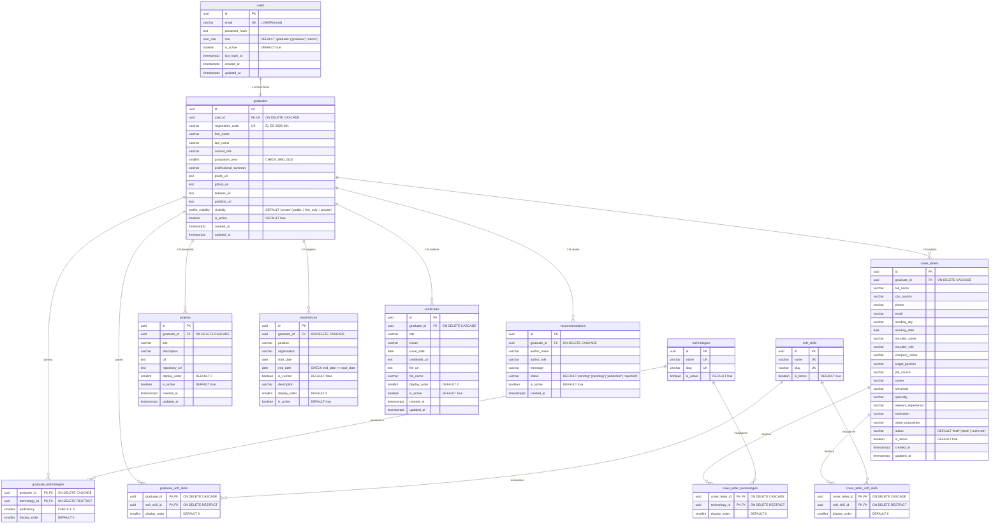

# Modelo Entidad-Relación (Base de Datos)

La base de datos PostgreSQL (`egresados_db`) utiliza la extensión `pgcrypto` para generar identificadores primarios `UUID` (`gen_random_uuid()`) y está compuesta por **9 entidades principales**, **4 tablas intermedias N:M** y **1 tabla de control de migraciones**.

---

## 1. Diagrama Entidad-Relación (Mermaid)

---

## 2. Tipos Enumerados (`ENUM`)

1. **`user_role`**:
   - `'graduate'`: Usuario estándar (valor por defecto al registrarse).
   - `'admin'`: Administrador con acceso al panel de Gestión.
2. **`profile_visibility`**:
   - `'public'`: Visible en las búsquedas del directorio público y accesible por enlace.
   - `'link_only'`: No aparece en el listado del directorio, pero puede consultarse conociendo su `registration_code`.
   - `'private'`: Oculto del directorio y del acceso público (valor por defecto al registrarse).

---

## 3. Diccionario de Tablas y Relaciones

| Tabla | Clave Primaria | Claves Foráneas / Relaciones | Reglas de Integridad (`CHECK` / `UNIQUE`) |
| :--- | :--- | :--- | :--- |
| **`users`** | `id` (UUID) | — | `email` único y en minúsculas (`email = LOWER(email)`). |
| **`graduates`** | `id` (UUID) | `user_id` → `users(id)` (`UNIQUE`, `ON DELETE CASCADE`) | `registration_code` único; `graduation_year BETWEEN 1950 AND 2100`. |
| **`technologies`** | `id` (UUID) | — | `name` y `slug` únicos. |
| **`soft_skills`** | `id` (UUID) | — | `name` y `slug` únicos. |
| **`graduate_technologies`** | `(graduate_id, technology_id)` | `graduate_id` → `graduates(id)` (`CASCADE`), `technology_id` → `technologies(id)` (`RESTRICT`) | `proficiency IS NULL OR proficiency BETWEEN 1 AND 5`. |
| **`graduate_soft_skills`** | `(graduate_id, soft_skill_id)` | `graduate_id` → `graduates(id)` (`CASCADE`), `soft_skill_id` → `soft_skills(id)` (`RESTRICT`) | Evita habilidades duplicadas por egresado. |
| **`projects`** | `id` (UUID) | `graduate_id` → `graduates(id)` (`ON DELETE CASCADE`) | Ordenado por `(graduate_id, display_order)`. |
| **`experiences`** | `id` (UUID) | `graduate_id` → `graduates(id)` (`ON DELETE CASCADE`) | `end_date IS NULL OR start_date IS NULL OR end_date >= start_date`. |
| **`certificates`** | `id` (UUID) | `graduate_id` → `graduates(id)` (`ON DELETE CASCADE`) | Almacena metadatos del certificado y ruta del archivo digital (`file_url`, `file_name`). |
| **`recommendations`** | `id` (UUID) | `graduate_id` → `graduates(id)` (`ON DELETE CASCADE`) | `status IN ('pending', 'published', 'rejected')`. |
| **`cover_letters`** | `id` (UUID) | `graduate_id` → `graduates(id)` (`ON DELETE CASCADE`) | `status IN ('draft', 'archived')`. |
| **`cover_letter_technologies`** | `(cover_letter_id, technology_id)` | `cover_letter_id` → `cover_letters(id)` (`CASCADE`), `technology_id` → `technologies(id)` (`RESTRICT`) | Máximo 2 tecnologías por carta validado en dominio. |
| **`cover_letter_soft_skills`** | `(cover_letter_id, soft_skill_id)` | `cover_letter_id` → `cover_letters(id)` (`CASCADE`), `soft_skill_id` → `soft_skills(id)` (`RESTRICT`) | Máximo 2 habilidades blandas por carta (y máx. 5 selecciones en total) validado en dominio. |
| **`schema_migrations`** | `name` (TEXT) | — | Registra qué archivos `.sql` de `migrations/` ya fueron aplicados. |

---

## 4. Índices de Rendimiento

Definidos en [`migrations/001_initial_schema.sql`](../migrations/001_initial_schema.sql):

- **`graduates_directory_idx`**: `ON graduates (visibility, graduation_year, last_name, first_name)` — Optimiza el filtrado y ordenamiento alfabético del directorio público.
- **`projects_graduate_order_idx`**: `ON projects (graduate_id, display_order)` — Optimiza la carga ordenada de proyectos en la ficha del egresado.
- **`experiences_graduate_order_idx`**: `ON experiences (graduate_id, display_order)` — Optimiza la carga ordenada de experiencias laborales.
- **`recommendations_graduate_status_idx`**: `ON recommendations (graduate_id, status, created_at DESC)` — Optimiza la consulta de recomendaciones publicadas por egresado.
- **`cover_letters_graduate_updated_idx`**: `ON cover_letters (graduate_id, updated_at DESC)` — Optimiza el listado de cartas de presentación del egresado.
